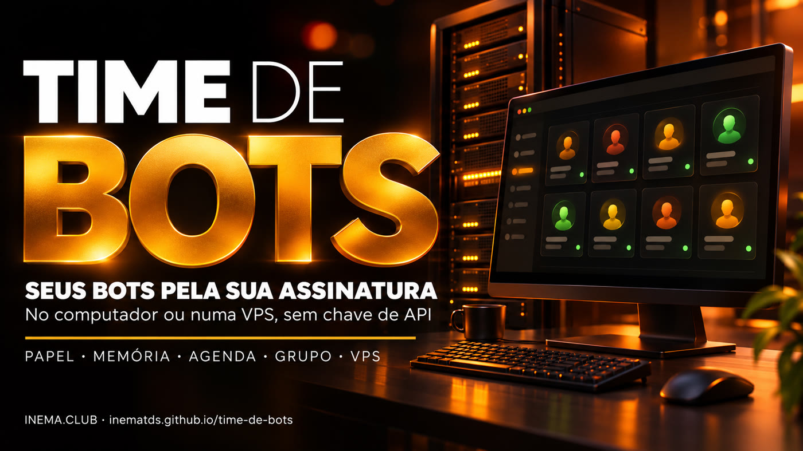

# Time de Bots — seus bots no computador e na VPS, pela sua assinatura

**🇧🇷 [Português](README.md) · 🇺🇸 [English](README.en.md) · 🇪🇸 [Español](README.es.md)**

## O que é

O Time de Bots é um kit gratuito do INEMA que instala um painel de bots no seu computador Linux ou Mac, ou
numa VPS. Cada bot tem nome, avatar, papel, memória e tarefas agendadas, e vocês conversam sozinhos ou em
grupo (`@bot`). As respostas vêm da **sua assinatura** do Claude ou do Codex, pelo login normal do programa
oficial, sem chave de API e sem cobrança por uso. Você pode ter vários times separados na mesma máquina.
Precisa de Node.js 22+ e de uma conta Claude ou ChatGPT com Codex.

## 📖 Guia de uso

Guia completo (landing + passo a passo): **https://inematds.github.io/time-de-bots/guia/**

## O que tem aqui

| Pasta | O que é |
|---|---|
| `app/` | O app de bots (Electron, licença MIT, ver `app/LICENSE`). Só trocamos o nome visível: [`kit/MUDANCAS-NO-APP.md`](kit/MUDANCAS-NO-APP.md) |
| `kit/instalar.sh` | Confere Node/npm, instala dependências, baixa os arquivos do app e roda os 193 testes |
| `kit/iniciar.sh` | Abre o app; `--instancia <nome>` cria outro time separado; tira qualquer chave de API do ambiente |
| `kit/scripts/conferir-resposta.mjs` | Prova que a resposta é real pela assinatura (não modo demonstração) e grava em `kit/verificacao/` |
| `kit/vps/` | Modo servidor: tela virtual + acesso pelo navegador **só por túnel SSH**, serviço que sobe sozinho, várias instâncias |
| `kit/prompts/` | Pedidos prontos para o Claude Code ou o Codex instalar e conferir por você |

## Três jeitos de usar

| Onde | Para quem | Como abre |
|---|---|---|
| **No seu computador** (Linux ou Mac) | quem quer os bots à mão | `kit/iniciar.sh` |
| **Outro time na mesma máquina** | separar pessoal e trabalho, ou um time por cliente | `kit/iniciar.sh --instancia trabalho` |
| **Numa VPS** | bots e tarefas agendadas ligados 24 h, acessados de qualquer lugar | `kit/vps/nova-instancia.sh principal 1` + túnel SSH |

## O processo, do início ao fim

Quem faz: 🧠 você numa sessão com o assistente · ⚙️ script do kit · 🤖 agente/modelo.

| # | Passo | Comando / arquivo | Quem |
|---|---|---|---|
| 1 | Baixar o kit | `git clone https://github.com/inematds/time-de-bots.git && cd time-de-bots` | 🧠 |
| 2 | Instalar e testar (193 testes) | `kit/instalar.sh` | ⚙️ |
| 3 | Entrar na sua conta (uma vez, no terminal) | `claude` ou `codex login` | 🧠 |
| 4 | Conferir uma resposta real pela assinatura | `node kit/scripts/conferir-resposta.mjs` | ⚙️ |
| 5 | Abrir o app | `kit/iniciar.sh` | ⚙️ |
| 6 | Em Settings → AI subscription, escolher Claude ou Codex e criar o primeiro bot | no app | 🧠 |
| 7 | (Opcional) outro time separado | `kit/iniciar.sh --instancia trabalho` | ⚙️ |
| 8 | (VPS) preparar o servidor, com usuário comum que tenha sudo | `kit/vps/instalar-vps.sh` | ⚙️ |
| 9 | (VPS) instalar o Claude Code ou o Codex no servidor e entrar na conta pelo SSH | `claude` ou `codex login --device-auth` | 🧠 |
| 10 | (VPS) ligar uma instância | `kit/vps/nova-instancia.sh principal 1` | ⚙️ |
| 11 | (VPS) abrir pelo navegador via túnel | `ssh -N -L 6081:127.0.0.1:6081 usuario@servidor` → `http://localhost:6081/vnc.html` | 🧠 |
| 12 | Preferir que o assistente faça 2–11 por você | [`kit/prompts/`](kit/prompts/) | 🤖 |

## O que foi testado (09/11/2026)

| Teste | Resultado |
|---|---|
| Testes do app (`npm test`) no Linux ARM64 | 193 de 193 |
| Testes do app numa VPS Ubuntu 24.04 x86_64 (4 vCPU, 15 GB) | 193 de 193 |
| Resposta real pela assinatura Claude (modelo haiku) | recebida em 3,8 s, login `claude.ai` |
| Duas instâncias ao mesmo tempo no computador | abertas, dados separados |
| Duas instâncias como serviço na VPS | ativas, portas só em 127.0.0.1 |
| Resposta real na VPS, Codex, voz, navegador na nuvem, Composio | **não testados** |

## Cuidados

- **Só assinatura.** O app só aceita o login `claude.ai` do Claude Code ou o login do Codex. O `kit/iniciar.sh`
  remove `ANTHROPIC_API_KEY`/`OPENAI_API_KEY` do ambiente para nada ir para cobrança por API sem você ver.
- **Limites continuam.** A assinatura tem limites de uso e termos do provedor; o painel não aumenta isso.
- **Login é seu.** Nunca cole token ou senha no chat do assistente; o login é feito por você no terminal.
- **VPS fechada.** Nada fica aberto para a internet: VNC e navegador ouvem só em 127.0.0.1, você entra por túnel SSH.
- **Software experimental**, sem garantia. Teste primeiro com uma instância descartável e faça backup de
  `~/.local/share/time-de-bots/` antes de atualizar.
- No Linux, o sandbox do Electron precisa de um ajuste com sudo: [`kit/COMO-LIGAR-SANDBOX.md`](kit/COMO-LIGAR-SANDBOX.md).

## Licença

Kit, guia e prompts do INEMA: [MIT](LICENSE). O app em `app/` tem a própria licença MIT e avisos de terceiros
(`app/LICENSE`, `app/THIRD_PARTY_NOTICES.md`), mantidos como a licença pede.

---

Feito pelo [INEMA.CLUB](https://inema.club).
