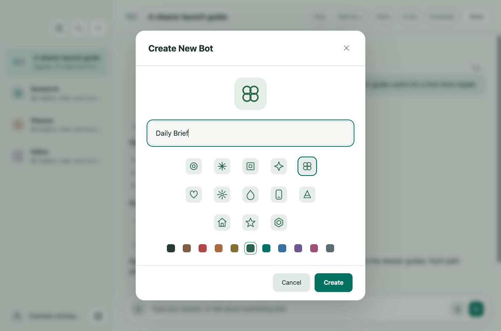
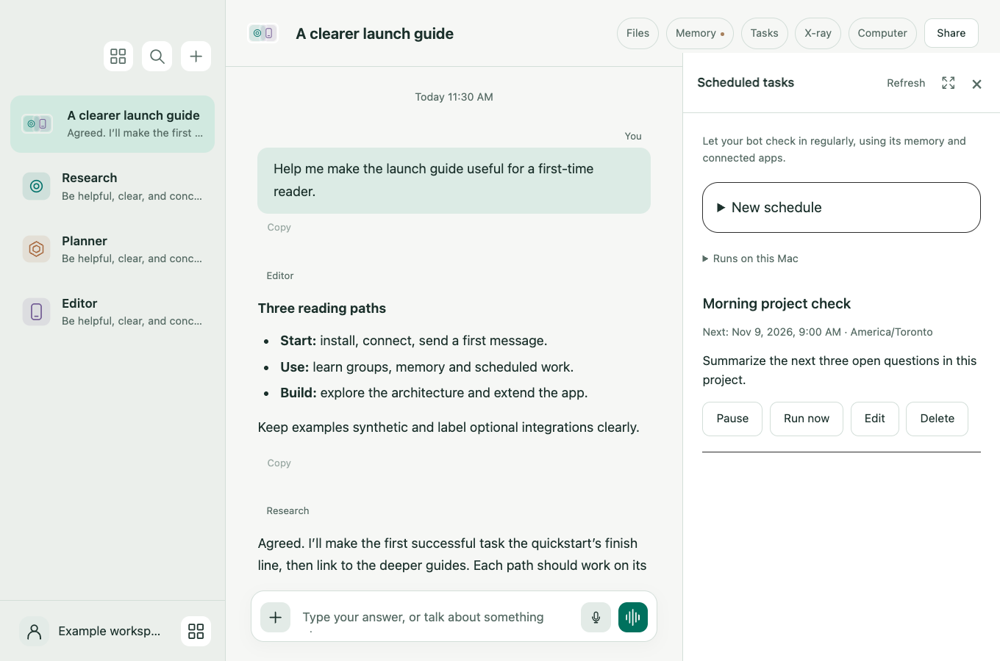

# Your first five minutes

Before installing, read the [installation and use notice](../DISCLAIMER.md). Review permissions and costs, back up your data, and try a disposable workspace first.

## 1. Install and launch

Use a Mac with Apple Silicon, Node.js 22+ and npm. Clone the repository and run the four commands in the main README. `npm run setup:assets` downloads a fixed revision of the semantic memory encoder and a fixed Composio CLI release, verifies checksums, and installs them only inside this checkout. It does not copy your account configuration or sign you in.

`npm start` opens **Gratis Core**. This edition uses its own local app data folder, separate from other editions. A fresh checkout starts with an empty demo conversation.

## 2. Choose a provider

Install and sign in to the provider's official client separately, following its documentation:

- [Claude Code setup](https://code.claude.com/docs/en/setup)
- [Codex setup](https://developers.openai.com/codex/quickstart/)

Open Settings, select the provider, and check the connection. Choose a model available to that account. Demo mode is only a local interface demonstration; it does not produce live research.

## 3. Give a bot a job

Create a bot with a name such as **Research** and describe the work you want it to do. Start with a small request you can verify, for example: “Explain this paragraph in three bullets.” You can later edit its instructions, model, avatar and tool capabilities.



## 4. Try a group

Create a group with two or more bots. The first bot coordinates the work. Most messages receive one answer; specialists join only when needed. Type `@` to choose a particular bot. Use `@everyone` when you actually want several independent answers.

## 5. Add recurring work

Open **+ → Scheduled tasks**, or ask: “Every weekday at 9 AM America/Toronto, summarize the open questions in this conversation.” Check the saved task, timezone and next run. Keep the Mac awake and Gratis running. You can pause, edit, delete or run the task now.



## Optional voice input

Voice input uses local Whisper transcription followed by optional Haiku punctuation cleanup. Haiku is not the audio transcription engine. The local text remains available if cleanup fails.

Install FFmpeg and the open-source Whisper CLI, then download the model you intend to use. One possible setup is:

```sh
brew install ffmpeg
python3 -m venv .venv-voice
. .venv-voice/bin/activate
python -m pip install openai-whisper
python -c "import whisper; whisper.load_model('base.en')"
npm start
```

Launch from this activated environment so Gratis can find `whisper` in `PATH`. English mode needs `base.en`; automatic-language mode needs `base`. Model downloads require disk space and network access. The app requests microphone access when you record.

## Optional connections

Use **+ → Connected apps** to sign in to your own Composio account and authorize individual apps. Credentials stay in encrypted local configuration. Cloud computers and T3 are separate optional services; see their guides before enabling them.
